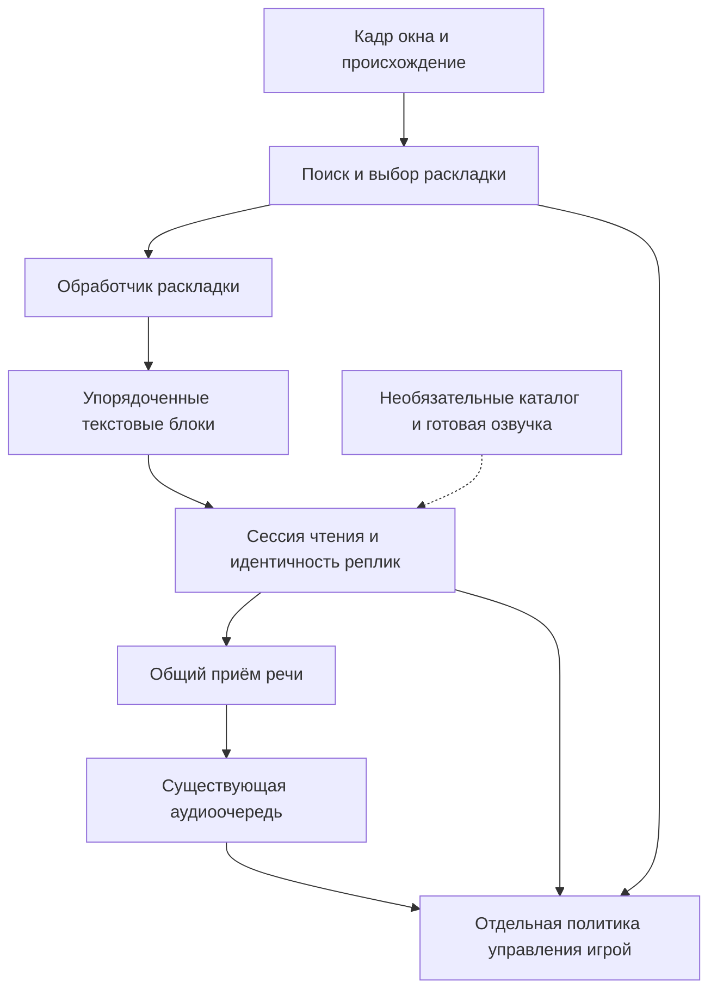

# Архитектура чтения разных раскладок текста

Статус: предложение для согласования. Это целевая архитектура и порядок
внедрения, а не описание уже работающего книжного режима. Производственный код
до согласования не меняется.

## Задача и границы

Поддержать обычный диалог визуальной новеллы, отдельную временную подпись
и прокручиваемую страницу. Обычный диалог должен сохранить нынешние качество,
стабилизацию и быстрый путь. Добавление другого оформления текста должно
затрагивать обработчик раскладки, а не распознавание, очередь и управление
игрой одновременно.

Главный сценарий — новая игра без разбора её ресурсов: выбрать окно, включить
живое чтение и озвучивать распознанный экранный текст. Специальный адаптер игры,
каталог реплик, план событий и подготовленные записи не являются зависимостями
этого пути. Оформление анализируется по изображению и последовательности кадров.

Общая инфраструктура уже есть: нативный захват окна, постоянный Tesseract,
очередь речи и защита управления от запоздалых результатов. Для исходного
маршрута дополнительно есть сопоставление с каталогом и идентификаторы событий.
Их используем повторно.
RapidOCR для поиска и чтения строк остаётся кандидатом дополнительной ветки;
обычный Tesseract им не заменяется.

Базовая приёмка сначала проверяет чтение без каталога. Каталог подключается
как дополнительная привязка и источник канонического текста/готового аудио.
Ошибка или отсутствие импортёра не препятствует живому чтению новой игры.
Игровые голосовые референсы также не обязательны: базовое чтение использует
доступный общий голос TTS/рассказчика. Установка самого выбранного TTS-движка
и его моделей остаётся общей подготовкой приложения, а не разбором новой игры.
Автоматическую прокрутку книги, распознавание игровых значков и понимание
любого произвольного интерфейса по одному изображению в этот объём не включаем.

## Основное разделение

Поиск отвечает на вопрос «где находятся строки». Обработчик раскладки —
«как они образуют подпись или абзацы». Сессия чтения — «это прежняя реплика
или новая и можно ли её принять». Очередь — «что и в каком порядке звучит».
Политика управления — «разрешено ли сейчас действие в игре».

Эти решения не заменяют друг друга. Высокая уверенность OCR не является
признаком сюжетного текста. Изменившиеся координаты не создают новую реплику.
Исчезновение текста не означает отмену уже принятой речи. Завершение речи
не означает разрешение нажать Space.

## Контракты данных

Это границы ответственности; отдельный класс на каждое понятие не требуется.
Новые типы вводятся только там, где нынешний одиночный результат теряет данные.

| Контракт | Содержимое | Владелец |
| --- | --- | --- |
| `CapturedWindowFrame` | Изображение в канонических координатах окна, время и существующее происхождение захвата | Захват |
| `LayoutSpec` | Стабильный ID, встроенный тип обработчика, разрешённая область, необходимые роли текста и политика навигации | Профиль и калибровка |
| `LayoutObservation` | Контекст кадра и раскладки, упорядоченные блоки текста, геометрия, признаки обрезания, уверенность и сведения о говорящем | Обработчик раскладки |
| `ReadingOccurrence` | Идентичность появления реплики в сессии, текст и говорящий, необязательная привязка к исходной строке, evidence полноты | Сессия чтения |
| Приём речи | Подтверждённый immutable `SpeechChunk` и имеющийся lease; результат постановки в очередь | Общая граница admission |
| Право перехода | Конкретный допустимый переход, привязанный к occurrence и актуальной визуальной цели | Политика навигации |

Блок содержит геометрию относительно канонического кадра, текст и роль/evidence
имени. Начальный префикс, обрезанное начало и внутренний фрагмент различаются.
Один `clipped` без указания края и полноты недостаточен.

`source_id` необязателен, идентичность occurrence обязательна. Даже без
исходного каталога повторяющиеся тексты могут принадлежать разным абзацам.
Не используется глобальное множество «все когда-либо прочитанные строки».
Локальный occurrence ID не записывается в `line_id` как выдуманная исходная
строка. Если привязки нет, она явно отсутствует, а речь получает текст из OCR.

## Обработчики раскладки

Встроенный реестр сопоставляет ключ типа конкретной реализации. ID области
произволен: по названиям вроде `center` или по координате Y логика не ветвится.
Внешний API плагинов, динамические импорты и отдельный движок на каждую игру
не нужны.

| Тип | Распознавание | Результат | Поведение текста |
| --- | --- | --- | --- |
| `dialogue` | Нынешние crop, поиск имени/диалога, Sauvola и постоянный Tesseract | Меняющаяся реплика | Замещение |
| `caption` | Поиск строк и text-only распознавание | Одна подпись, при необходимости перенесённая на строки | Замещение |
| `document` | Тот же поиск и чтение строк, сохранение абзацев и evidence имён | Упорядоченный видимый диапазон документа | Поток документа |

Реализации `caption` и `document` разделяют сервис детекции/чтения строк,
но по-разному собирают наблюдение. Книжная страница не передаётся дальше
как одна склеенная строка. Имя относится к своему абзацу; заголовок или первая
строка не отбрасывается только потому, что похожа на имя.

Роль говорящего уточняется существующей привязкой к источнику и правилами
голосов. При отсутствии достаточной evidence используется рассказчик;
неуверенное определение имени не должно уничтожать текст. Для произвольного
оформления имён может понадобиться другой обработчик, а не усложнение общего
парсера исключениями.

Обработчик предоставляет операции оценки визуального evidence и распознавания.
Ему принадлежат presence, fingerprint и evidence завершённости именно его
раскладки. Он не меняет позицию истории, не ставит аудио в очередь и не
отправляет клавиши. Белая страница не проходит через проверку ярких символов
обычного нижнего диалога.

## Захват, профили и калибровка

Нативный источник захватывается один раз. Каноническое изображение сохраняется
до выбора области; необходимые crop получаются из него. Нативные API менять
не требуется: полный кадр уже материализуется до нынешней обрезки.

Области нормализованы относительно одного и того же `content_rect` на macOS
и Windows. Readers не знают про координаты рабочего стола, macOS points,
Windows HWND или повторное вычитание рамки окна.

Существующий настроенный профиль сохраняет обычный диалог и его быстрый путь.
Для новой игры выполняется bootstrap из текущего окна после явного Read на
сюжетном экране: детектор предлагает область и подходящий встроенный reader
по расположению строк, их группировке и наблюдаемому изменению текста.
При достаточной evidence начинается живое чтение; при неоднозначности preview
предлагает подтвердить область либо выделить её вручную. Сложная обязательная
настройка всех видов раскладок для каждой игры не требуется.

В профиле сохраняются полученные `LayoutSpec`, включая подтверждённые
автоматические предложения. Пользователь может уточнить область и тип,
добавить подпись или страницу; preview показывает читаемые строки и роли.
Правая страница отделяется от левой карточки и кнопок разрешённой областью,
без правила по названию конкретной игры. Выбор нового окна/игры не наследует
каталог и позицию прежней игры без явного подключения соответствующего профиля.

Области могут пересекаться. Это не означает разрешение читать один текст
несколькими обработчиками. Совпадающие наблюдения объединяются до admission.
Подпись не обязана находиться в центре, а страница не обязана занимать всё окно.

Нынешние `dialog_region` и `ocr_regions` при загрузке преобразуются в один
`dialogue` spec. Нормализованное внутреннее представление только одно.
Сохранение записывает новый формат; чтение прежнего остаётся только в явной
миграции на входе. Глобальная калибровка и профиль используют одну схему.
Маркер `coordinate_space` сохраняется. Старые desktop/неизвестные координаты
не объявляются каноническими при миграции: нынешнее требование перекалибровки
остаётся в силе. Чтение такой области не включается до исправления калибровки.
Существующий override области сохраняет прежний приоритет и относится к
основному диалогу, а не растягивает все дополнительные области.

## Автоматический выбор и стоимость поиска

Начальное обнаружение типичных поддерживаемых раскладок в новой игре входит
в основной объём. Поиск может исследовать кадр окна, но найденные строки не
получают автоматического права на речь только из-за своих координат/confidence.
Явный старт на сюжетном экране задаёт контекст чтения; bootstrap формирует
области-кандидаты, selector подтверждает их по доступному evidence или запрашивает
уточнение области. Далее используются текущие подтверждённые области и поиск
новых кандидатов. Универсальное понимание любого меню по одному кадру не
обещается. Ручное уточнение — резервный способ запуска без разработки адаптера.

### Допуск сюжетного текста и выход в меню

Область поиска, наличие текста и право озвучивания — разные условия.
Кандидат должен находиться в разрешённой области и принадлежать подтверждённой
сюжетной раскладке текущей сессии. Например, левую информационную карточку
отделяем от правой страницы книги калибровкой; confidence её надписей не важен.

В обычном экранном чтении право принять сюжетный OCR определяется областью,
сессией и стабилизацией, независимо от наличия каталога. Необязательный matcher
может уточнить исходную идентичность, говорящего и канонический payload, а
аудиомаршрут — выбрать готовую запись. Отсутствие соответствия в каталоге
не блокирует допустимое живое чтение экрана. При этом matcher не выполняет
глобальный поиск любой похожей надписи и не разрешает читать меню.

Существующее явно source-bound/sequence-чтение сохраняет строгую authority
источника. В нём отсутствие исходного соответствия не заменяется произвольным
OCR, а отсутствие готового аудио может разрешать синтез известной канонической
реплики по прежней политике. Наличие пакета само по себе не превращает
экранное чтение новой игры в этот строгий режим. Текстовая authority отделена
от выбора аудиоисточника.

При исчезновении подтверждённой сюжетной раскладки новое admission и управление
игрой приостанавливаются. Завершение уже принятой речи остаётся отдельной
политикой FIFO. Достаточного подтверждения нового экрана нет — чтение его текста
не начинается только по факту обнаруженных букв. Возврат требует свежего
подтверждения сюжета, а не наличия текста в старых координатах.

Это ограничение не является универсальным распознавателем «сюжет или меню».
Без каталога меню может визуально совпасть с оформлением истории. Такие случаи
нельзя гарантированно различить по одному кадру; приёмка должна проверить
реальные меню/оверлеи и определить предел автоматики. Ручная Pause остаётся
резервным действием, а не заменой автоматической приостановки на явно
несюжетном экране. Обхода «не узнали раскладку — прочитать весь экран» нет.

### Планирование поиска

Обычная область распознаётся прежним способом. Дополнительные области
проверяются независимо: рост текста или неизменный нижний диалог не должен
полностью выключать discovery. Его вызов располагается до нынешнего
`visual-only` short-circuit, иначе временная цитата поверх старого диалога
останется незамеченной.

У дополнительного сервиса один исполнитель и один заменяемый ожидающий кадр.
Очередь снимков не накапливается. Он не занимает lock постоянного Tesseract.
Детекция использует уменьшенное изображение, чтение — исходные crop.
Результаты поиска переиспользуются обработчиками подписи и документа.

Общий scheduler в live-сессии владеет очередностью проверок и максимальной
задержкой discovery для неактивных областей. Поток обновлений активной книги
не должен вытеснять поиск временной подписи. Scheduler не начинает новый
длинный проход активной области, если подошёл срок проверки альтернативы;
у выполняющегося прохода есть ограничение времени. Selector владеет сроком
актуальности кандидата и удержанием admission. Ошибка или истечение срока
отзывают кандидат, но не выбирают другую раскладку по таймауту: новое admission
возобновляется только по свежему достаточному evidence. Зависание задачи не
превращается в бесконечную скрытую блокировку — причина публикуется в статусе.

Сервис создаётся лениво при bootstrap новой игры либо включении дополнительных
раскладок; заранее настроенные `LayoutSpec` для bootstrap не требуются. Модели
и зависимости проверяются на границе подготовки через существующие механизмы
assets/установки; reader не скачивает и не устанавливает их на каждом запуске
OCR. Недоступная модель делает соответствующую раскладку явно недоступной,
сохраняя работоспособность обычного reader. Установка и проверка моделей,
их упаковка и завершение worker входят в поставку соответствующего изменения.

После обнаружения устойчивой геометрии достаточно проверять известные блоки
и изменения области. Периодический повторный поиск остаётся нужен, чтобы
заметить новый текст вне них. Яркость и разность кадров помогают планировать
поиск, но не доказывают наличие текста. Частота discovery и срок актуальности
кандидата выбираются по измерениям задержки и загрузки, не становятся набором
пользовательских настроек.

Правила выбора сосредоточены в одном selector:

- Явный выбор раскладки пользователем имеет приоритет.
- Неизменный текст активного диалога, повторно найденный внутри большой области,
  не является новым кандидатом и не переключает режим.
- Новый устойчивый текст вне прежних text-role областей может стать кандидатом,
  даже если старый нижний диалог остаётся видимым.
- Геометрия, текст, происхождение и изменения соседних кадров рассматриваются
  совместно. Средние confidence разных crop не сравниваются как рейтинг режимов.
- При конкурирующей новой evidence selector временно удерживает новое admission
  и автопереход. Уже принятая речь продолжает звучать. После устранения
  неоднозначности выбирается раскладка; не делается произвольный выбор по центру
  экрана, размеру прямоугольника или таймауту.
- Возврат требует свежего evidence. Старый закешированный диалог не активируется
  повторно только потому, что исчезла страница.

Это проверяемая стратегия, не доказанная универсальная классификация. Её
приёмка обязательно включает старый нижний текст под новой цитатой, одновременно
меняющиеся области, анимацию, перекрытие и возврат к диалогу.

## Сессия чтения: разные способы изменения текста

Сессия чтения является единственным владельцем идентичности и приёма в речь,
но не смешивает порядки разных документов. У каждого контекста документа
своя позиция и граница приёма; общая FIFO имеет порядок подтверждённого
admission. Временная подпись между абзацами книги не сбрасывает позицию книги.
`layout_id` не является ID документа: другая история в той же области получает
другой контекст. С каталогом контекст привязан к выбранному источнику/главе;
без него непрерывность подтверждается соседними наблюдениями либо явным
запуском. Неподтверждённое возвращение не наследует чужую позицию автоматически.

Разные раскладки могут показывать один документ и даже одну исходную реплику.
При подтверждённой привязке это один контекст и прежнее occurrence, пока нет
evidence нового появления. Если временная подпись принадлежит тому же исходному
документу, её admission обновляет его позицию; независимая подпись имеет свой
контекст замещения. Смена reader сама по себе новую идентичность не создаёт.

Сессия получает структурированные наблюдения; capture и readers не
поддерживают собственные конкурирующие списки прочитанного.

### Замещаемая подпись

Обычный диалог и отдельная цитата используют семантику замещения. Существующий
`IncrementalDialogTracker` остаётся основой стабилизации, печатающегося текста
и нарезки речи, но идентичность occurrence получает от сессии чтения. Нынешний
самостоятельный учёт принятых source ID переносится под этого владельца:
`accepted_line_ids` не остаётся вторым независимым запретом повторного чтения
нового occurrence той же исходной строки. Смена размеров, reflow или продолжение
печати уточняет прежнее
появление текста. Подтверждённый переход или новая исходная строка создаёт
другое occurrence. Одинаковая фраза после реального перехода может быть прочитана
снова.

Одинаковые соседние подписи без наблюдаемого перехода принципиально неразличимы.
Архитектура не устраняет это выдуманным таймаутом или хешем текста.

### Поток документа

Сессия хранит наблюдаемый диапазон документа отдельно от границы уже принятого
чтения. Прокрутка двигает viewport в обе стороны, но не откатывает автоматическую
позицию этого документа. Временно прикрытый документ сохраняет свой контекст;
явная смена источника или завершение сессии освобождает его по жизненному циклу.

С каталогом используются исходные ID, порядок, существующий matcher и его
full/prefix evidence. `resolve_observation_among(..., update_context=False)`
оценивает видимые блоки без перемещения позиции при каждом поиске. Принятая
позиция обновляется после подтверждения общей границей admission.

Без каталога создаются локальные упорядоченные occurrences. Соседние viewport
сопоставляются по общей последовательности абзацев, текстовому evidence и
согласованному перемещению блоков. Координаты помогают сопоставлению, но не
служат ключом. Одинаковые строки в разных местах сохраняют отдельную идентичность.

Поведение по умолчанию:

- Первый запуск начинается с первого достаточно определённого видимого абзаца.
  Невидимые предшествующие абзацы не достраиваются.
- Уже принятый абзац не принимается заново после прокрутки, reflow или обрезания.
- Новый полный абзац впереди позиции принимается в порядке документа.
- Частичный блок может подтвердить известную реплику. Полный канонический текст
  по префиксу разрешается только существующей bounded coverage authority,
  а не любым похожим фрагментом страницы.
- У нового фрагмента без каталога не дописывается невидимое окончание.
  Обрезанный сверху суффикс не объявляется начальным префиксом.
- При большом скачке без overlap или однозначной исходной привязки позиция
  удерживается до достаточного evidence либо явного нового запуска чтения.
- Ранее не виденный абзац позади принятой позиции не запускает чтение назад.
  Это правило позиции, а не фильтр «служебного текста».

Существующие Read/Stop/Repeat и source-backed resync остаются явными действиями
пользователя. Новую панель управления документом заранее не добавляем.

## Admission, очередь и запоздалые результаты

Переиспользуются `SpeechChunk`, occurrence leases, FIFO, ограничение подготовки
речи и cancellation. Проверка canonical source authority применяется только
к соответствующему исходному маршруту. Для экранного OCR без каталога действуют
локальная идентичность occurrence, стабилизация и актуальность сессии.
Отдельная очередь для книги не нужна.

Наблюдение страницы может дать несколько кандидатов. Они принимаются последовательно
в порядке документа: идентификация, разрешение чтения, подтверждённый приём,
обновление границы. Нельзя сначала выставить последнюю generation всего batch,
а затем пытаться принять предыдущие chunks.

Принятие не равно успешному воспроизведению. Используется существующий учёт
queued/playing/completed/failed/cancelled. Не принятый кандидат не считается
прочитанным. Ошибка не превращается в бесконечный повтор на каждом OCR-кадре.
Уточнение до первого PCM может использовать нынешнее unheard replacement;
после начала воспроизведения исправление OCR не создаёт полный дубль.

В соответствии с выбранным поведением чтения уже принятые реплики, включая
ещё ожидающие FIFO, сохраняются при смене изображения или раскладки. Принятая
подготовка аудио также не отменяется просто из-за исчезновения текста.
Stop/Clear, завершение сессии и явная смена игрового контекста используют
существующие действия отмены. Переключение визуальной раскладки ими не является.

Устаревший результат не может менять текущую геометрию или давать право на
автоклавишу. Результат кадра, снятого в действующей сессии, может завершить
распознавание уже исчезнувшей цитаты: сессия оценивает его по времени наблюдения,
источнику и позиции соответствующего контекста. Если в том же замещаемом контексте
уже принято следующее occurrence либо позиция документа ушла дальше, прошлое
не принимается заново. Результат не вставляется задним числом в FIFO и не
перемещает позицию назад. Позиции разных документов и временной подписи при
этом не сравниваются как один исходный номер: книга может продолжиться после
подписи со своей сохранённой позиции. Это решение admission, а не blanket drop
по смене layout.

Пока подтверждённый альтернативный кандидат распознаётся, selector удерживает
приём конкурирующего нового содержания. Это помогает сохранить порядок,
не останавливая уже звучащую речь. Текст, показанный и исчезнувший между
доступными проверками, обнаружить гарантированно нельзя; максимальная задержка
discovery должна быть измеряемым свойством реализации.

## Управление игрой

Политика навигации отделена от OCR и типа текста. Профиль явно разрешает guarded
advance для нужной области; общий пользовательский toggle и имеющийся план
событий продолжают ограничивать действие. Наличие имени или положение блока
не дают такого разрешения.

- Обычный диалог сохраняет нынешнюю политику guarded advance.
- У новых подписей и страниц по умолчанию ручное управление; timed/passive
  событие источника никогда не превращается в интерактивное.
- Завершение абзаца книги не означает Space. Автоматическая прокрутка и переход
  страницы требуют отдельного наблюдаемого контракта и в первый объём не входят.
- При смене визуальной цели старое право перехода отзывается сразу. Старая речь
  может завершиться, но её callback не управляет новым экраном.
- Focus, принадлежность occurrence и условия завершения проверяются существующей
  общей границей перед действием, а не копируются в каждый reader.

## Контексты и инвалидирование

Переиспользуем существующие run/session/occurrence механизмы. Их смысл не
объединяется в один флаг `current`.

| Изменение | Что перестаёт быть актуальным | Что само по себе сохраняется |
| --- | --- | --- |
| Размер окна, native layout epoch, восстановление захвата | Геометрия, визуальные fingerprints и незавершённые view-кандидаты | Уже принятая речь; идентичность документа при подтверждённой непрерывности |
| Активная раскладка | Прежняя визуальная цель и право автоперехода | Принятые occurrences и FIFO той же сессии чтения |
| Прокрутка | Координаты и видимый диапазон | Позиция принятого чтения и уже принятые абзацы |
| Явный Stop/Clear, смена игры/профиля или источника | Данные по существующей политике жизненного цикла | Только то, что уже сохраняет соответствующий публичный контракт |

`frame_route_epoch` уже является ревизией admission/freshness, поэтому не
становится ID раскладки. `DialogLayoutSession` получает контекст выбранной
раскладки и не переносит speaker/dialogue rectangles на страницу.

Проверки сосредоточены на границах: схема профиля при загрузке, актуальность
результата при возврате задачи, имеющаяся canonical authority при исходном admission,
право действия перед вводом. Readers не перечитывают аудиофайлы и не повторяют
проверки источника на каждом кадре.

## Расширение

Новая раскладка добавляет обработчик и регистрацию типа. Он выдаёт тот же
`LayoutObservation` и выбирает уже существующую семантику замещения или документа.
Источник, голоса, очередь, отмена и навигация не переписываются.

Новый способ изменения содержания добавляет политику сессии только тогда,
когда его нельзя выразить имеющимися семантиками. Новый OCR backend подключается
через сервис распознавания, независимо от новых раскладок. Никаких
`if game == ...` или веток по имени конкретного персонажа в общем конвейере.

Например, для сообщений переписки, оформленных как в мессенджере, новый reader
определяет границы, говорящего и порядок сообщений. Если это пополняющийся
документ, он использует прежнюю
семантику документа; аудиоочередь и сопоставление источников остаются теми же.
Это иллюстрация расширения, а не дополнительная функция первого объёма.

## Размещение и миграция

Предлагаемые модули, уточняемые в рамках соответствующего изменения:

| Область | Ответственность |
| --- | --- |
| `dialog_capture.py`, `native_capture.py`, `window_capture.py` | Единый канонический кадр и происхождение; нативный transport остаётся прежним |
| `text_layouts.py` | Контракты layout/observation, выбор и контекст активной области |
| `layout_readers.py`, существующие `ocr.py`/`ocr_backend.py` | Встроенные readers и повторное использование OCR; ограниченный alternate worker |
| `reading_session.py`, существующий `live_tracking.py` | Occurrences, семантика замещения/документа, позиция и admission proposals |
| `chapter_voice_preload.py`, `story_text_matching.py` | Общая исходная привязка и текстовое evidence |
| `live.py`, `controller.py`, `controller_components.py` | Общая оркестрация, подтверждение admission, существующая речь и управление |
| `profiles.py`, калибровка и preview | Одна схема областей, миграция, отображение распознаваемого содержимого |
| Diagnostics, capture/replay и однократное чтение | Те же наблюдения и readers, без собственной классификации раскладок |

`AppController` остаётся фасадом и composition root. Построение и жизненный цикл
новых collaborators относятся к существующему `LiveSessionComponent` и его
узким портам; публичные методы фасада не становятся координаторами режимов.
`DiagnosticsComponent` и preview получают те же readers с изолированным
наблюдением, без побочного перемещения текущей позиции или admission речи.

Миграция идёт работоспособными изменениями. В каждом изменении переносятся все
потребители заменяемого контракта и удаляется вытесненный путь. Обычный reader
остаётся полноценной реализацией нового контракта, а не постоянно включённым
legacy bypass. Не оставляем два независимых runtime API калибровки или admission.

## Порядок внедрения и гейты

Планы конкретных изменений согласуются отдельно; выполнение отмечается только
в корневом TODO, а не превращает этот документ в журнал.

Первый поставляемый результат — исправление пропущенного текста по центру
в уже записанной главе. Общие изменения ниже выполняются в объёме, необходимом
для обычного диалога и временной подписи. Этап завершается отдельной проверкой
этого перехода до начала книжного reader, прокрутки и учёта абзацев. Решение
не привязывается к игре или фиксированным центральным координатам; запуск новой
игры без ресурсов остаётся проверкой переносимости этого же этапа.

1. Ввести общие frame/layout/observation контракты и перенести обычный диалог.
   Одновременно мигрировать профиль, глобальную калибровку, preview, diagnostics,
   one-shot и replay. Гейт: прежние результаты и OCR-вызовы обычного пути,
   настроенный профиль без дополнительных раскладок не запускает alternate worker.
2. Выделить единый приём occurrence для обычного диалога и подписи, сохранив нынешнюю
   стабилизацию и аудиоочередь; перенести самостоятельную identity authority
   трекера под владельца сессии. Гейт: ранняя каноническая речь, повторы,
   отмена, Pause/Resume, FIFO и запоздалое завершение сохраняют поведение;
   базовое экранное чтение работает при явно отсутствующих исходных ресурсах.
   Позиция и overlap прокручиваемого документа реализуются на книжном этапе.
3. Подключить подписи, ограниченный discovery/selector и bootstrap новой игры
   без каталога. Гейт: предложение области на незнакомом оформлении, живой TTS
   без извлечения ресурсов, ручное уточнение при неопределённости; цитата поверх
   неизменного нижнего диалога, исчезновение/возврат, меню и шум, отсутствие
   поздней клавиши, сохранение принятой речи. Прежний профиль/каталог не
   подставляется при выборе другой игры. До перехода к книге проверить
   пропущенные центральные цитаты из записи главы, переход нижний диалог ->
   подпись -> нижний диалог и текущий маршрут готовой озвучки. Не ждать общего
   прогона книжного режима, чтобы подтвердить исправление исходного дефекта.
4. Подключить документ: порядок блоков, имена, clipped evidence и overlap
   без каталога; сохранить необязательное исходное сопоставление.
   Гейт: прокрутка в обе стороны,
   появление новых абзацев, одинаковый текст в разных местах, краевые фрагменты,
   отсутствие повтора и сохранение очереди при исчезновении текста; временная
   подпись между абзацами, одна реплика в разных раскладках и другой документ
   в той же настроенной области.
5. Проверить необязательную интеграцию исходного текста и готовой озвучки,
   включая неизменность строгих sequence-маршрутов. Ошибки или отсутствие
   каталога в обычном экранном чтении не блокируют валидную OCR-речь.
6. Провести общий реальный прогон прежде всего в новой игре без каталога,
   адаптера и извлечения ресурсов. Включить другое оформление текста,
   переключение раскладок, меню и возврат. Дополнительно проверить текущую игру
   с готовой озвучкой и фоновой генерацией.
   Измерить задержку обнаружения/приёма, OCR-вызовы и влияние на обычный диалог.
   Статические замеры модели не заменяют этот гейт. Общий image/config contract
   тестируется для macOS и Windows; числа скорости проверяются на реальном хосте,
   а не переносятся с одной платформы на другую.

Нынешние тесты и сохранённые кадры служат регрессией, а не поводом переписывать
обычные thresholds. Новые тесты проверяют границы владения и пользовательское
поведение, а не наличие классов из этого документа. Требуемые проверки выбора
тестов остаются описанными в README.

### Независимое улучшение импортёра

Раскрытие известных ссылок через локализованные заголовки до classification/hash
остаётся нужным исправлением для подготовленной речи анекдотов. Сохраняются
неизвестные числовые литералы, ID и порядок строк; затронутая речь пересоздаётся
после переимпорта. Эта работа не является зависимостью конвейера OCR и не
блокирует запуск живого чтения другой игры.

## Что ещё не доказано

Надёжный selector при одновременно меняющихся областях, коротких временных
подписях и перекрытии. Неперекрывающиеся переходы документа без каталога.
Приемлемая конкуренция alternate worker с чтением и генерацией.

Эти ограничения закрываются явными экспериментами и приёмкой. Они не должны
превращаться в скрытые эвристики, глобальное ослабление OCR-порогов или
исключения для конкретных кадров.
